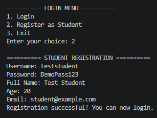
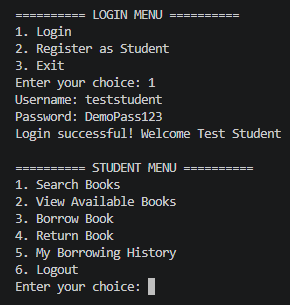
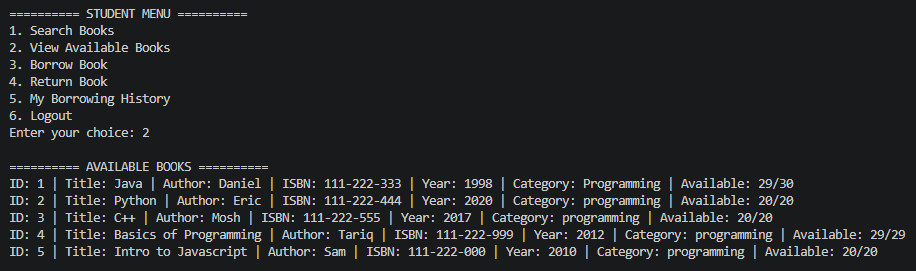
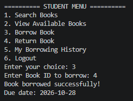
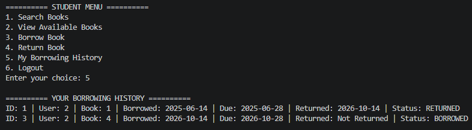
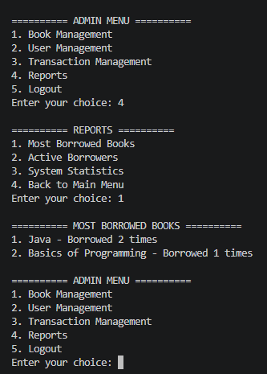

# 📚 TermiLib


**A terminal-based library management system developed in Java, featuring role-based menus, book inventory management, borrowing and returns, and persistent file storage.**

## Overview

TermiLib is a console-based application created as a Programming Fundamentals semester project. It provides separate interfaces for administrators and students, helping manage library records without requiring a database server or graphical interface.

## Features

- **Authentication:** Administrator login and student registration/login.
- **Book management:** Add, update, remove, search, and list books.
- **User management:** Manage student accounts and search user records.
- **Borrowing and returns:** Record book issues, returns, and borrowing history.
- **Reports:** View overdue books, popular books, active borrowers, and library statistics.
- **File persistence:** Store application records in local text files.

## Tech Stack

| Component | Technology |
|---|---|
| Language | Java |
| Interface | Command-line interface (CLI) |
| Storage | Text files using Java I/O |
| Dependencies | Java standard library |

## Project Structure

```text
TermiLib/
├── src/main/
│   ├── auth/          # Authentication logic
│   ├── managers/      # Books, users, transactions
│   ├── models/        # Domain models
│   ├── utils/         # File handling and validation
│   └── TermiLib.java  # Main entry point
├── data/              # Local application records
├── .gitignore
└── README.md
```

## Getting Started

### Prerequisites

- Java Development Kit (JDK)
- Terminal or IDE with Java support

### Compile and run

Run these commands from the project root:

```bash
javac -d out src/main/*.java src/main/auth/*.java src/main/managers/*.java src/main/models/*.java src/main/utils/*.java
java -cp out main.TermiLib
```

The application uses the `data/` directory for its text files. Keep the working directory at the project root when running it.

On first launch, the application creates a default administrator account if one does not exist. **This demonstration account uses insecure hard-coded credentials and must not be used for real deployments.**

## Screenshots


## Application Screenshots

The following screenshots demonstrate the core functionality of TermiLib.

### 1. Login & Student Registration

Users can register a student account and authenticate through the terminal interface.



### 2. Student Dashboard

The student dashboard provides access to book searching, borrowing, returns, and borrowing history.



### 3. Book Inventory

Students can browse available books and view their details, including author, ISBN, category, and available copies.



### 4. Book Borrowing

The system records borrowing transactions and generates due dates.



### 5. Borrowing History

Students can view their borrowing records and transaction statuses.



### 6. Administrator Dashboard & Reports

Administrators can access management features and generate library reports, including most-borrowed books.




## Architecture

- **Models:** Represent books, users, and transactions.
- **Managers:** Implement application operations and record management.
- **Auth:** Checks login credentials and user roles.
- **Utils:** Provide text-file persistence and input validation.
- **TermiLib.java:** Handles the interactive console menus.

## Learning Outcomes

This project demonstrates Java fundamentals, control flow, methods, modular code organization, object usage, input validation, exception handling, and file I/O.

## Security Limitations

TermiLib is an educational prototype, not a production-ready library system.

- Passwords are compared directly rather than using secure password hashing.
- A default administrator is created with hard-coded demonstration credentials.
- Text-file storage is not suitable for sensitive production records.

## Future Improvements

- Implement salted password hashing and secure account setup.
- Add automated tests and input-validation improvements.
- Migrate persistence to a database.
- Improve error handling and user experience.

## Academic Context

**Course:** Programming Fundamentals  
**Project:** TermiLib  
**Author:** Muhammad Talha Sultan  
**Institution:** COMSATS University Islamabad

## Disclaimer

Developed for academic and educational purposes. The authentication and storage mechanisms are demonstrations and should not be deployed with real personal data without appropriate security improvements.
  